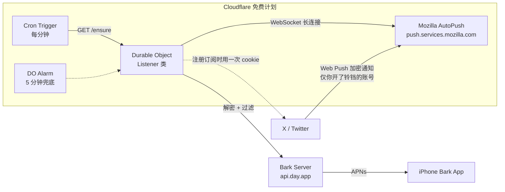

# x2bark-push 原理详解

本文解释这个项目**为什么能做到**：不用 X 官方付费 API、不爬虫、不轮询，却能把推文通知**秒级**推到手机，并且完整跑在 Cloudflare Workers 免费计划上。

- [一句话原理](#一句话原理)
- [整体架构](#整体架构)
- [核心机制一：Mozilla AutoPush 协议](#核心机制一mozilla-autopush-协议)
- [核心机制二：Web Push 消息加密](#核心机制二web-push-消息加密)
- [核心机制三：向 X 注册订阅](#核心机制三向-x-注册订阅)
- [通知类型与文案（对照）](#通知类型与文案对照)
- [工程决策与踩坑记录](#工程决策与踩坑记录)
- [免费额度分析](#免费额度分析)
- [安全模型](#安全模型)
- [致谢](#致谢)

---

## 一句话原理

**X 的网页版推送走的是 Mozilla AutoPush（Firefox 的推送基础设施）。我们伪装成一个"浏览器设备"完成 Web Push 订阅注册，让 X 把通知主动推给 Mozilla、Mozilla 再通过 WebSocket 长连接推给我们 —— 之后解密、转发到 Bark 即可。**

换个角度说：你在 x.com 网页版点开通知时收到的那些浏览器推送，本来就能被任何一个实现 Web Push 协议的客户端接收。这个项目就是在 Cloudflare 的一个 Durable Object 里实现了一个永不下线的"浏览器通知接收器"。

---

## 整体架构



消息完整流转：

1. **注册阶段**（只发生一次或 cookie 更新后）：DO 生成 ECDH P-256 密钥对 → 连 AutoPush 拿到推送 endpoint → 带 cookie 调 X 的内部 API `POST /1.1/notifications/settings/login.json`，告诉 X「把通知发到这个 endpoint」
2. **监听阶段**：DO 与 AutoPush 保持 WebSocket 长连接，挂机等待
3. **触发阶段**：你关注并开铃铛的账号发推 → X 决定向你账号的所有"推送设备"发通知 → 用注册时上交的公钥加密通知 → 发给 Mozilla AutoPush
4. **投递阶段**：AutoPush 通过 WebSocket 把密文推给 DO → DO 先 `ack`（防丢）→ 用私钥解密 → 按类型过滤 → 拼好文案交给 Bark
5. **到达阶段**：Bark 通过 Apple APNs 把通知推到 iPhone

---

## 核心机制一：Mozilla AutoPush 协议

AutoPush 的 WebSocket 端点：`wss://push.services.mozilla.com/`。这是 Firefox 浏览器后台运行的推送通道，协议是 JSON 文本帧，消息类型如下。

### 1. hello —— 建立会话

```json
{
  "messageType": "hello",
  "use_webpush": true,
  "uaid": "<上次会话的用户ID，首次为空串>",
  "channelIDs": ["<已持有的 channel>"],
  "broadcasts": {}
}
```

服务端回应新的（或复用的）`uaid`。**两个关键字段的设计意图**：

- **`uaid`**：用户身份。持久化并在重连时带上，服务端就认得你——本项目把它存进 DO storage，所以跨部署、跨驱逐都稳定。重连后 `uaid` 保持不变。
- **`channelIDs`**：声明自己已持有的 channel。**这是整个稳定性的关键**：带上它，服务端直接复用旧 channel，**连 register 都不用发**，endpoint 长期不变；而且断线期间到达的通知会在 hello 之后立即补投（排队在 uaid 下，而不是 channel 下，所以旧身份不丢消息）。

### 2. register —— 注册推送 channel

```json
{ "messageType": "register", "channelID": "<uuid>", "key": "<VAPID 公钥>" }
```

服务端回应：

```json
{ "messageType": "register", "status": 200, "pushEndpoint": "https://push.services.mozilla.com/wpush/v2/gAAAA..." }
```

这个 `pushEndpoint` 就是交给 X 的"设备地址"。VAPID（Voluntary Application Server Identification）是 Web Push 标准的一部分，这里的公钥取自 Firefox 客户端使用的同一把（X 只校验格式）。

### 3. notification —— 通知投递

```json
{
  "messageType": "notification",
  "channelID": "<uuid>",
  "version": 1234567890,
  "data": "<base64url 的加密载荷>",
  "headers": { "crypto_key": "dh=...", "encryption": "salt=...;rs=..." }
}
```

`data` 是**端到端加密**的密文（见下一节），AutoPush 自己也读不了内容。

### 4. ack —— 确认

收到 notification 后必须回：

```json
{ "messageType": "ack", "updates": [{ "channelID": "...", "version": 1234567890, "code": 100 }] }
```

本项目**先 ack 再解密**：解密/推送失败不影响确认，避免 AutoPush 反复重投同一通知。代价是极端情况（解密失败）会丢这一条，收益是绝不重复轰炸。

### 连接生命周期

```
connecting → ws open → hello ok（uaid 复用，跳过 register）
  → 连接存活 1~2 分钟
  → 被 Cloudflare 运行时回收（ws closed code=1006）
  → 1 秒内自动重连（指数退避，成功即重置）
```

平台会周期性回收空闲 DO，这**无害**：重连只要 1 秒，断线窗口的通知靠 AutoPush 排队 + hello 补投兜住，实际表现为消息一条不丢、延迟最多 1 分钟，多数时候仍为秒级。

**一个重要教训（写进代码注释）**：不要发高频 ping 保活。每 5 秒发一次协议 ping，AutoPush 会在第 2 次 ping 后以 `code=1011 reason=SM` 主动断连——Firefox 客户端自己是几分钟才 ping 一次。高频保活反而把连接寿命从 ~2 分钟压到 15 秒。

---

## 核心机制二：Web Push 消息加密

AutoPush 投递的 `data` 是标准 Web Push 加密（RFC 8291 的 `aes128gcm`/`aesgcm` 变体）。X 在注册订阅时拿到了我们的**公钥**（`encryption_key1`）和 **auth secret**（`encryption_key2`），发通知时用它们加密——**只有持有私钥的我们能解**，Mozilla 和 Cloudflare 全程只见密文。

解密流程（`listener.js` 的 `decryptPayload`，全部用 Workers 原生 `crypto.subtle` 实现）：

```
1. ECDH P-256：用我们的私钥 + 通知头里的临时公钥(crypto_key 的 dh) 派生共享密钥 (256 bit)
2. HKDF-SHA256：
   ikm   = HKDF(authSecret, sharedSecret, "Content-Encoding: auth")   → 32B
   cek   = HKDF(salt, ikm, "Content-Encoding: aesgcm" + context)      → 16B （AES-128-GCM 密钥）
   nonce = HKDF(salt, ikm, "Content-Encoding: nonce" + context)       → 12B （GCM IV）
   context = "P-256" + 两端公钥的长度前缀拼接（ RFC 8291 规定的 keyid 上下文）
3. AES-128-GCM 解密：
   - 单块模式（rs=0）：直接用 nonce 解
   - 分块模式（rs>=18）：按 rs 切块，第 i 块的 nonce = 原始 nonce 与 i 做特定位异或（adjustNonce）
4. 去掉前 2 字节 padding 长度 + padding，得到 JSON 明文
```

明文 payload 结构（X 的通知载荷）：

```json
{
  "title": "某用户昵称",               // 通常是发送者昵称
  "body": "推文内容… /用户名/status/123", // 正文，链接常是相对路径
  "icon": "https://pbs.twimg.com/...",   // 头像
  "data": { "type": "tweet", "uri": "/用户名/status/123", ... }
}
```

本项目的文案处理：把相对路径 `/用户名/status/ID` 就地补全为 `https://x.com/用户名/status/ID`，让正文里的链接可点。

---

## 核心机制三：向 X 注册订阅

拿到 endpoint 后，要告诉 X「这是我们设备，通知发这里」。这一步用 X 网页版自己使用的内部接口：

```
POST https://x.com/i/api/1.1/notifications/settings/login.json
```

请求要点（对应 `listener.js` 的 `registerWithX`）：

| 请求要素 | 值/来源 | 说明 |
|---|---|---|
| 认证 | cookie `auth_token` + `ct0`，`x-twitter-auth-type: OAuth2Session` | **cookie 唯一的使用场景**，仅这一次 |
| CSRF | `x-csrf-token: <ct0>` | ct0 同时是 cookie 和 csrf token |
| API 授权 | `authorization: Bearer <公共 bearer token>` | X 网页版内置的公共 token |
| 伪装 | 请求头模板从 fa0311 的 latest-user-agent 拉取 | 跟随最新 Chrome 指纹 |
| 防火墙 | `x-client-transaction-id` | X 的反机器人头，需按其算法生成（见下） |
| 设备信息 | `push_device_info` | 见下 |

`push_device_info` 是整个机制的灵魂：

```json
{
  "os_version": "Web/Chrome",
  "udid": "Web/Chrome/<随机 UUID>",      // 每次注册生成唯一设备 ID
  "env": 3,                               // Web 环境
  "protocol_version": 1,
  "token": "<AutoPush endpoint>",
  "encryption_key1": "<我们的公钥>",      // X 用它加密通知
  "encryption_key2": "<我们的 auth secret>"
}
```

**`udid` 唯一化的教训**：最初版本写死 `udid: "Web/Chrome"`，收不到任何通知——X 按 udid 维护设备记录，固定 ID 时新注册可能不覆盖旧记录，推送全发给了早已失效的旧 endpoint。改成每次注册生成唯一 udid 后问题消失。

**`x-client-transaction-id`**：X 前端给每个请求算的一个混淆头（时间戳 + 方法/路径的 SHA-256 + 动画密钥 XOR）。本项目移植了 xnotif 的实现：`generateTransactionId` 从 fa0311 维护的 pair 字典随机取一组 verification/animationKey，算法细节见 `listener.js`。这是 X 侧唯一"复杂"的对抗点，也是上游失效风险所在（X 改算法需要上游更新）。

### 订阅会失效：为什么需要定期重注册

注册不是「一劳永逸」的。X 会在一段时间后把这条 Web Push 订阅**在服务端静默失效**——你这边一切正常，却再也收不到推送，且没有任何报错。这正是「全托管自愈」要解决的问题，这里讲清根因。

**两套相互独立的「半边订阅」：**

1. **X 侧的 device 记录**：`login.json` 注册时在 X 服务端写入一条设备记录（`udid` + AutoPush endpoint + 加解密密钥），含义是「把这个账号的通知，投递到 endpoint E」。这条记录归 X 所有。
2. **AutoPush 侧的 WebSocket + endpoint**：由我们的 DO 维护的长连接和推送接收地址，归我们所有。

两者通过 endpoint 字符串关联，但生命周期互相独立。X 可以在「完全不通知我们」的情况下，单方面把它的 device 记录过期 / 回收，而我们的 WebSocket 依然连着、endpoint 字符串也没变。

**为什么会失效：**

- 每次注册我们都用**全新的随机 `udid`**（见上 `udid` 唯一化的教训），对 X 而言每次注册都是一个「新设备」。
- X 似乎对 Web Push 的设备记录设有**服务端 TTL / 闲置回收**：一条没被「刷新」过的旧设备记录，过一段时间就不再被投递。典型表现是突然收不到推送，但 `/status` 仍 `connected: true`、endpoint 未变、`lastError` 为空——单看状态完全正常，这正是「静默断流」难排查的原因。
- 而我们的 `ensure()` 一旦发现 uaid 还能复用（`savedEndpoint === currentEndpoint`），就**跳过重注册**——它以为「什么都没变，不用重新告诉 X」。于是 X 那侧的失效记录永远得不到刷新，表现成「静默断流」。

**为什么定期重注册能解决：**

`registerWithX()` 本质是用当前 endpoint 向 X 重新写一条 device 记录（新 `udid`）。只要周期性地（默认每 12h）做一次，X 那侧的设备记录就被不断续期，订阅就不会悄悄死掉。即使 X 哪天真把它清了，距离上次重注册超过 `RE_REGISTER_HOURS` 的下一次 cron 也会自动补上——这就是「第一重·定时自愈」（见[工程决策 #9](#工程决策与踩坑记录)）。

> 手动 `/register` 同理：你发现收不到时打一次，就是用新 `udid` 把 X 那侧记录救活。自愈逻辑只是把这件事自动化、避免手动遗漏；且手动与自动互不干扰（见 #9 计时拆分）。

---

## 通知类型与文案（对照）

`data.type` 共 6 种值。Bark 通知的标题/正文/链接按下面规则生成——只有 4 个特殊分支，其余原样透传 X 的文案：

| 事件 | `type` | Bark 标题 | Bark 正文 | 链接 |
|---|---|---|---|---|
| 点赞你的推 | `favorite` | `被 <点赞者> 点赞` | 被赞推的正文 | `x.com/<handle>/status/<tag ID>` |
| 关注你 | `follower` | 账号显示名 | `@<handle> 关注了你！` | `x.com/<handle>` |
| 回复你的推 | `reply` | 账号显示名 | `@<handle> 回复说： <内容>` | `x.com/<handle>/status/<tag ID>` |
| 私信 | `xchat_message_received` | 发送者显示名 | `发送了一条私信`（内容端到端加密，读不到） | `data.uri`（chat 会话链接） |
| 原创推文 / 引用 | `tweet`（tag ID == uri ID） | 账号显示名 | 推文正文（原样） | `x.com/<handle>/status/<tag ID>` |
| 回复别人 / 转推 | `tweet`（tag ID ≠ uri ID） | 账号显示名 | `@对方: 正文`（原样） | `data.uri`（对方原推的 canonical 链接） |
| @提及你 | `mention` | 账号显示名 | 含 @你的正文（原样） | `x.com/<handle>/status/<tag ID>` |

结论：

- **`type` 与 tag 前缀**：可见 `tweet-` / `reply-` / `mention-` / `favorite-` 前缀和字面量 `follower`；X 官方博客还提到过 `retweet-` / `message-`，说明前缀随版本演化，**判定不要依赖 tag 前缀**
- **回复别人 vs 转推**：payload 完全同构（都是 `tweet` + tag ID ≠ uri ID），无法细分；引用和原创同理（都是 `tweet` + tag ID == uri ID）
- **reply 的正文格式**：原文为 `@<handle> replied: <内容>`，从不带斜杠（历史上出现过 `@//<handle>/` 形式的变体，属转发伪影而非真实载荷）。代码仍用 `@\/{0,2}` 宽松兼容，格式突变匹配不上时原样透传，不造文案
- **`multi_title` / `bundle_text`** 里的 `{num_total, plural...}` 是 X 的客户端聚合模板（多条同类通知折叠计数用），可参考 [X 官方工程博客](https://blog.x.com/engineering/en_us/topics/infrastructure/2019/user-centric-web-push-aggregation)。**注意**：纯图片/无文字推文的 `data.body` 是空串，取正文必须用空值合并运算符 `??` 而非逻辑或，否则空串被短路后会误用 `bundle_text`，Bark 里会显示 `{num_total, number} new ...` 原始模板；正文为空时与 X 网页版一致只推标题、不带正文
- 通知按 `tag` 去重（最近 50 条）；tag 不带 ID 的类型（关注、私信）改用 `type + 唯一标识`（handle / 消息 ID）兜底，同一事件重复投递不重复推送，不同事件不误杀

---

## 工程决策与踩坑记录

按时间顺序记录几个关键决策，供移植其他 Web Push 服务时参考：

1. **DO 而非普通 Worker 挂连接**：普通 Worker 的请求处理结束后 isolate 即销毁，WebSocket 活不过一个请求。DO 在有活跃连接/定时器时保持存活，是 Workers 平台上托管长连接的正解。

2. **cron 每分钟 + alarm 5 分钟兜底 + 指数退避**：三层保障。
   - cron（`* * * * *`）负责"DO 被驱逐/新部署后 1 分钟内恢复"
   - DO alarm 是 cron 失效时的最后防线
   - `scheduleReconnect` 断线后 1s 起步指数退避（上限 5 分钟），连接成功即重置——平台每 ~2 分钟回收连接，实际远到不了上限

3. **不发高频 ping**：见上文连接生命周期说明（1011/SM）。「空闲回收 → 快速重连 → hello 补投」的组合比保活更省心。

4. **endpoint 稳定化**：hello 带 `channelIDs` 后，重连走 uaid 复用路径，register 和向 X 的注册都跳过。此前每次重连都 register + 向 X 注册（~1440 次/天），虽然没被风控但毫无必要。

5. **先 ack 后解密**：保证不重复推送，容忍单条解密失败。

6. **Workers 运行时兼容点**：
   - Node 的 `Buffer` 在 Workers 不存在 → 全部改用 `atob/btoa` + `Uint8Array`
   - 分块解密时 `crypto.subtle.decrypt` 的密文参数必须是 `ArrayBuffer`，`Uint8Array` 直接传会在 `DataView` 处炸（上游 xnotif 在 Node 下隐式依赖 Buffer 的行为掩盖了这一点）

7. **DO 状态持久化**：uaid、channelId、endpoint、ECDH 密钥对（JWK）、auth secret 全部存 DO storage。重新部署/驱逐后自动恢复身份，不重复注册。

8. **推送用 POST 而非 GET**：Bark 的 `GET /<key>/<标题>/<正文>` 在只有一段内容时会把那段当**正文**、标题被应用名顶替，空正文的通知标题就变成「Bark」。改用 `POST /push` + JSON 精确控制字段（空正文干脆不带 `body`），正文另截断 400 字符。文案映射细节见上文[通知类型与文案（对照）](#通知类型与文案对照)。

9. **推送链路自愈（两重自动重注册）**：X 会周期性地把推送订阅在服务端静默失效，而 Worker 的 AutoPush 长连接仍在、endpoint 也没变，于是代码因「uaid 复用跳过 registerWithX」永远不向 X 重注册 → 表现为「收不到但无报错」（根因见上文[订阅会失效：为什么需要定期重注册](#订阅会失效为什么需要定期重注册)）。为此加了两道自动重注册，都带 1h 退避（两次重注册最小间隔 1h，避免疯狂重注册）：
   - **第一重（定时）**：`RE_REGISTER_HOURS`（默认 12）控制，距上次【自动】重注册超过该时长就重注册一次，让订阅定期刷新。
   - **第二重（静默）**：`SILENCE_HOURS`（默认 0 = 关闭，建议 2）控制，连续这么久没收到 X 推送（不含 `/test`）就重注册一次，作为定时之外的快速恢复。
   - **退避只统计自动重注册**：用独立的 `lastAutoRegisterAt` 计时，手动 `/register` 只更新 `lastRegisterAt`（仅 `/status` 展示）而不触碰 `lastAutoRegisterAt`。所以手动救活后，自动自愈仍按原节奏兜底，不会被 1h/12h 时间压制——手动与自动互不干扰。
   - `lastNotificationAt` 改为持久化到 DO storage（原仅内存，实例重启即丢），且 `/test` 不走通知路径、不刷新该时间戳，所以静默监测不会被测试误触发。

---

## 免费额度分析

| 限制项 | 免费计划额度 | 本项目实际消耗 | 占用 |
|---|---|---|---|
| Worker 请求 | 100,000 次/天 | ~1,440（cron）+ 手动访问 | <2% |
| Worker CPU 时间 | 10 ms/次 | 0–2 ms（等待不计费） | 安全 |
| DO 请求 | 100,000 次/天 | ~1,730/天 | <2% |
| DO 存储 | 5 GB | 几 KB | 可忽略 |
| Cron Triggers | 5 个/账号 | 1 个 | 20% |
| 连接数 | 6 并发/请求 | 1 个 WebSocket | 安全 |
| 内存 | 128 MB | 几 KB 的 JSON/密文 | 安全 |

关键认知：Workers 计费/限制的是 **CPU 时间**而非挂钟时间——WebSocket 挂着等通知、等待 Bark 响应这些时间全部免费。这正是"免费跑常驻监听"成立的前提。

---

## 安全模型

- **你的 cookie（auth_token/ct0）**：等于 X 账号登录凭证。仅通过 `wrangler secret put` 写入（加密存储在你的 Cloudflare 账号），**只在向 X 注册订阅的那一刻使用**，日常监听零调用。请勿提交到 git 或分享给任何人。
- **通知内容**：X → Mozilla → Cloudflare 这一段是端到端加密（AES-128-GCM），Mozilla 与 Cloudflare 都只见密文。解密发生在你自己的 DO 里，之后转给 Bark 服务器时是明文——介意内容经过第三方可自建 bark-server，`BARK_SERVER` 变量已预留。
- **解密密钥**：ECDH P-256 私钥只存在你自己的 DO storage 里，从不外发（公钥在注册时交给 X）。

---

## 致谢

- [xnotif](https://github.com/yutakobayashidev/xnotif)（yutakobayashidev）：本项目的核心机制（AutoPush 协议、解密、X 注册、transaction-id 生成）移植自它，做的是 Workers 化适配与稳定性改造。
- [fa0311](https://github.com/fa0311)：维护的 [latest-user-agent](https://github.com/fa0311/latest-user-agent) 与 [x-client-transaction-id-pair-dict](https://github.com/fa0311/x-client-transaction-id-pair-dict) 提供了浏览器指纹与 transaction-id 算法素材。
- [Bark](https://github.com/Finb/Bark)：iOS 端免费推送通道。
